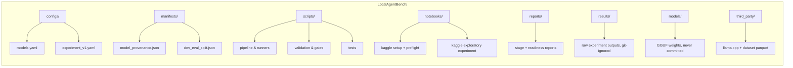
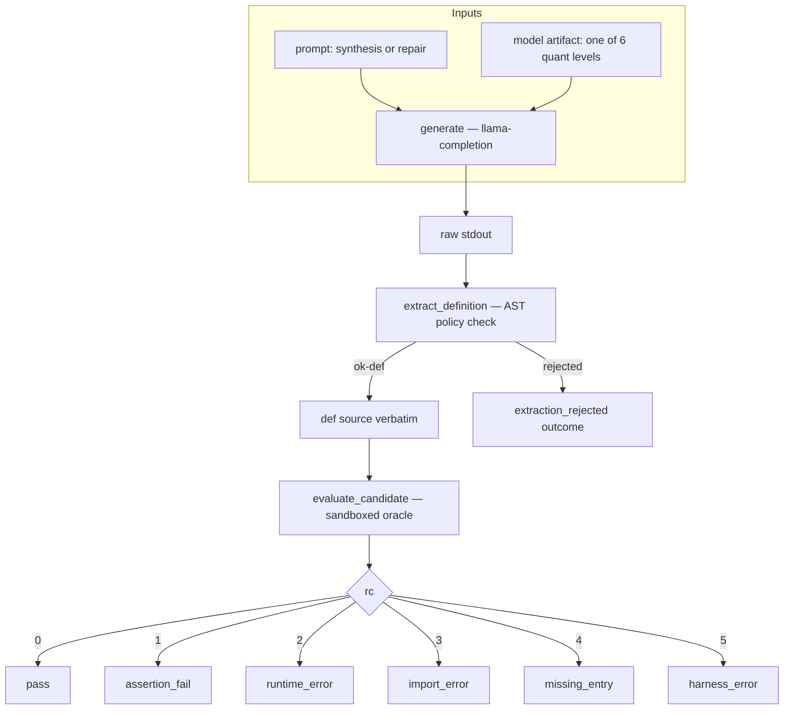
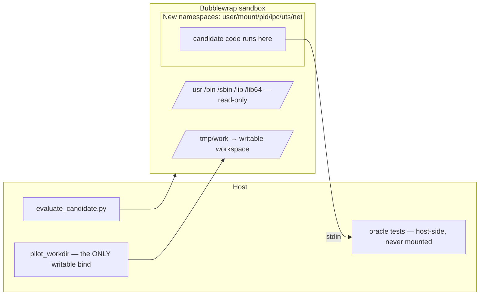
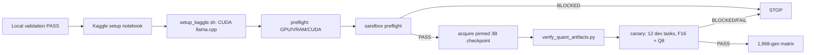

# LocalAgentBench

**A controlled evaluation harness for quantization effects on code synthesis vs. repair in small local LLMs.**

LocalAgentBench measures whether **model quantization** changes functional correctness **differently** for **code synthesis** and **code repair** when both task modes are derived from the *same underlying programming problem* and scored by the *same hidden tests*.

```
Research question
  Does quantization affect functional correctness differently between code synthesis and
  code repair when both task modes are paired by the same underlying programming problem?
```

| | |
|---|---|
| Primary model | Qwen2.5-Coder-3B-Instruct (`revision 488639f1…ec5`, Qwen Research license) |
| Precision ladder | F16 · Q8_0 · Q6_K · Q4_K_M · Q3_K_M · Q2_K (all from one source checkpoint) |
| Dataset | HumanEvalPack Python — 164 tasks, paired synthesis/repair, shared hidden tests |
| Split | 12 development / 152 evaluation tasks (frozen manifest) |
| Runtime | llama.cpp (`llama-completion`), CPU locally · CUDA on Kaggle |
| Sandbox | Bubblewrap — model-generated code runs only sandboxed |

---

## Status

| Phase | State |
|---|---|
| Stage 0–6 foundation (env, build, model, sandbox, dataset) | ✅ verified |
| Stage 7 pilot (A/B/C, 10-task) | ✅ executed — **floor effect** documented (1.5B) |
| Model migration (1.5B → **3B**) | ✅ approved |
| Local preparation + hardening | ✅ PASS (`reports/pre_kaggle_readiness.md`) |
| Kaggle preflight → canary → 1,968-gen matrix | ⛔ **gated** — awaiting approval |

---

## Repository layout



| Path | Purpose |
|---|---|
| `configs/models.yaml` | model selection, quantization ladder, conversion pipeline, resource estimates |
| `configs/experiment_v1.yaml` | experiment definition: matrix, output contract, metrics, canary gate |
| `manifests/model_provenance.json` | source revision/license/hashes + generated-artifact registry |
| `manifests/dev_eval_split.json` | frozen 12-dev / 152-eval split |
| `scripts/` | pipeline, validation, gates, tests (see below) |
| `notebooks/` | Kaggle setup/preflight and exploratory-experiment notebooks |
| `reports/` | stage reports + readiness verdicts |
| `results/` | raw outputs (git-ignored) |
| `models/`, `third_party/` | weights (never committed) and upstream checkouts |

---

## Core pipeline



Every cell records: task ID, mode, model artifact hash, prompt hash, token counts, generation time, termination reason, extraction status, functional correctness, and error class. Raw generation stdout is preserved for reproducibility.

---

## Safety model



- Model-generated code runs **only** inside the validated sandbox.
- Ground-truth tests travel over **stdin** and are never model-writable.
- `kaggle_sandbox_preflight.sh` verifies the sandbox before any generated code executes; **no unsandboxed fallback ever**.

---

## Key scripts

| Script | Role |
|---|---|
| `pilot_runner.py` | experiment orchestrator: generate → extract → evaluate (reused by canary) |
| `run_canary.py` | 12-task feasibility canary with BLOCKED/FAIL/PASS verdicts |
| `evaluate_candidate.py` | sandboxed oracle evaluator (v3.2, canonical path) |
| `sandbox.sh` | Bubblewrap policy wrapper |
| `validate_dataset.py` | oracle validation: 164/164 canonical pass, buggy fail |
| `validate_pairing_164.py` | pair + leak + shared-test + mandatory-oracle validation |
| `task_split.py` | frozen dev/eval split generator + verifier |
| `quantize_gguf.sh` | idempotent F16 + 5 quantizations from one source |
| `verify_quant_artifacts.py` | provenance verification: sha256, size, GGUF metadata |
| `setup_kaggle.sh` / `run_kaggle_preflight.sh` | Kaggle build + GPU preflight |
| `kaggle_sandbox_preflight.sh` | 8-probe sandbox gate |
| `validate_prep_artifacts.py` | master local validation gate (all checks + tests) |

See [`docs/EXPERIMENT_PIPELINE.md`](docs/EXPERIMENT_PIPELINE.md) for the full experiment design and [`docs/HARDENING_SAFEGUARDS.md`](docs/HARDENING_SAFEGUARDS.md) for the hardening/gates detail.

---

## Quick start (local validation)

```bash
cd ~/projects/LocalAgentBench

# 1. Oracle + pairing validation
.venv/bin/python scripts/validate_dataset.py
.venv/bin/python scripts/validate_pairing_164.py --require-oracle

# 2. Frozen split
.venv/bin/python scripts/task_split.py --verify

# 3. Sandbox preflight (local)
bash scripts/kaggle_sandbox_preflight.sh

# 4. Master local gate (syntax + all regression suites)
.venv/bin/python scripts/validate_prep_artifacts.py
```

> No experiment, canary, model download, or quantization is executed by any of the above.

---

## Kaggle path (gated)



Each step is gated; nothing runs until the previous gate passes and explicit approval is given.

---

## Project state notes

- Git: `master`, **no remote configured yet**; prep files are untracked and ready for a user-approved commit.
- Model weights (`models/`), raw results (`results/`), and third-party checkouts are git-ignored.
- The 1.5B model and all prior pilot results are preserved as historical records.
