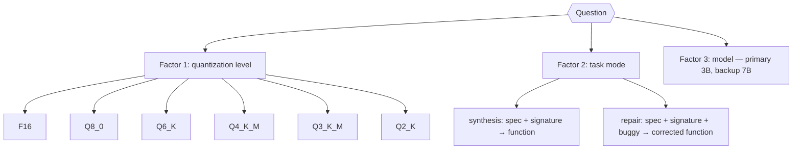
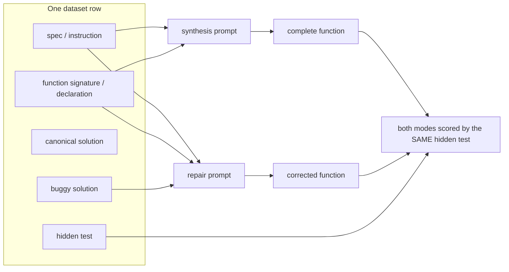
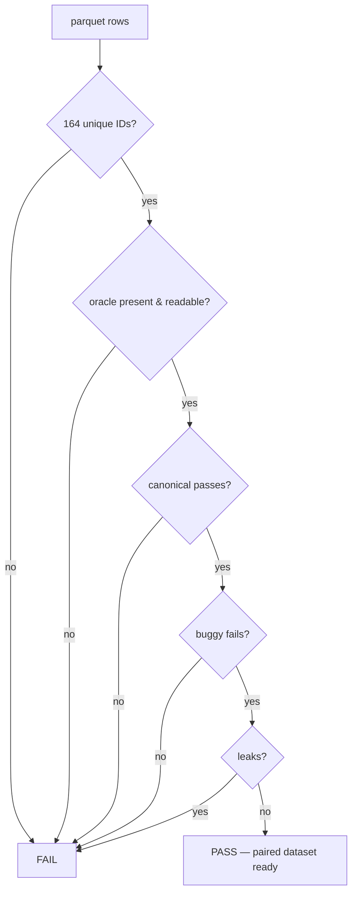
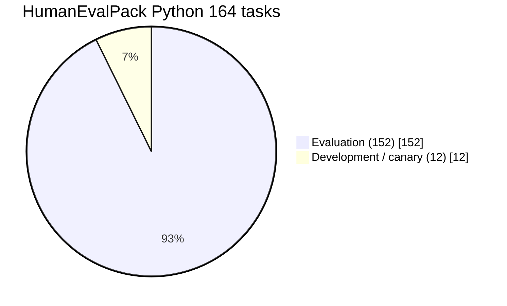
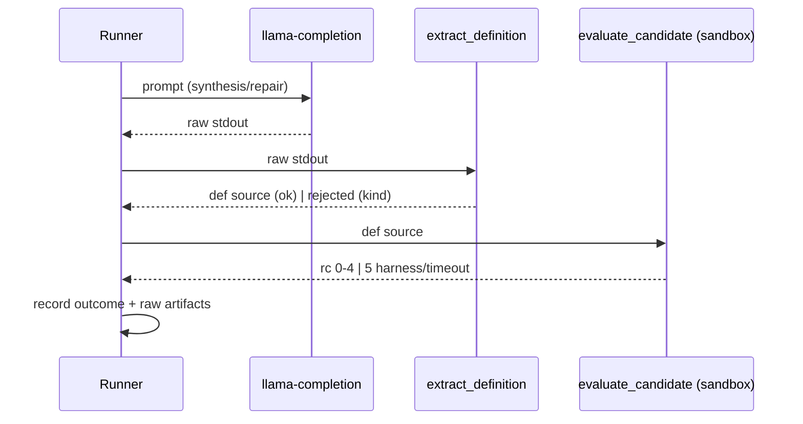
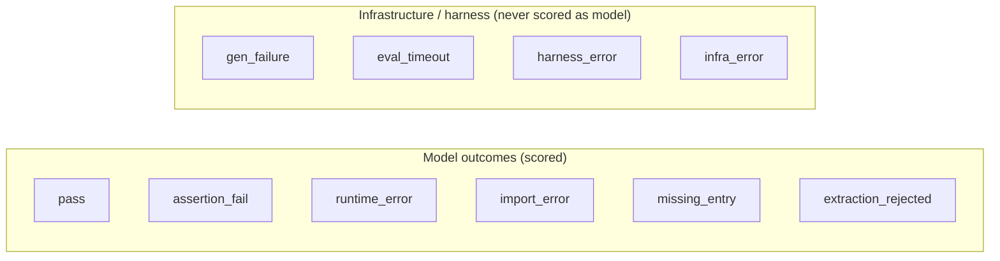
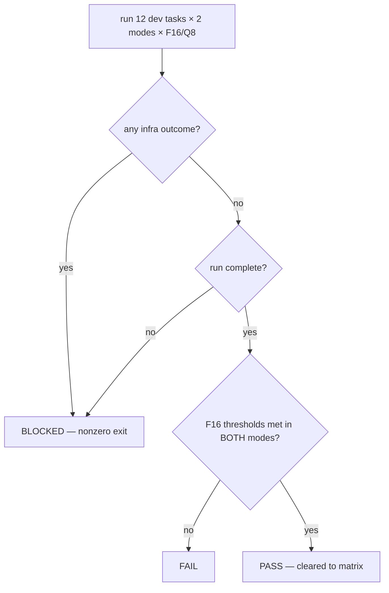
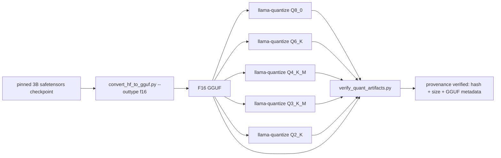

# Experiment Pipeline — LocalAgentBench

This document describes the research design, task construction, generation
protocol, evaluation, and metrics that make up the main experiment.

---

## 1. Research question

> **Does model quantization affect functional correctness differently between code synthesis and code repair when both task modes are paired by the same underlying programming problem?**

### Hypotheses (provisional, pre-registered before analysis)

| ID | Hypothesis | Type |
|---|---|---|
| H1 | Quantization × task-mode interaction: the effect of lower precision on functional success differs between synthesis and repair | confirmatory |
| H2 | Failure-mode distribution shifts with quantization (format vs. logic vs. truncation) | secondary |
| H3 | Tokens-per-success trade-off: the fastest quant level is not the cheapest per solved task | secondary |
| H4 | The 3B model clears the floor (non-zero success in both modes at F16) | feasibility gate |

---

## 2. Paired task construction

Every underlying problem yields **two** task forms from the **same** row of the
164-task HumanEvalPack Python dataset.

- Synthesis prompt: spec + signature only.
- Repair prompt: spec + signature + `# BUGGY:` block.
- The hidden test is **identical** for both modes (verified by fingerprint in `validate_pairing_164.py`).
- **Leak control:** hidden tests and canonical solutions never appear in prompts; canonical prefix inside the buggy block is benign and recorded as a covariate (`bug_type`, edit distance).

### Dataset validation (fail-closed)

- 164 unique task IDs.
- Every synthesis/repair pair shares the underlying problem and the same test.
- Oracle: 164/164 canonical pass, 164/164 buggy fail.
- `--require-oracle` makes a missing oracle a hard error for the main dataset.

---

## 3. Development / evaluation split

The 12-task canary must never enter the confirmatory sample.

- Frozen manifest: `manifests/dev_eval_split.json`
- Method: seeded deterministic — sorted IDs, every 14th → 12 dev; remainder eval.
- Verified invariants: dev ∩ eval = ∅, dev ∪ eval = 164, counts 12/152, deterministic.

---

## 4. Generation protocol

| Setting | Value |
|---|---|
| Runtime | `llama-completion` (llama.cpp, pinned commit) |
| Output contract | exactly one complete function definition, raw source; no JSON, no fences |
| Max tokens | 512 |
| Context | 4096 |
| Temperature | 0.0 (greedy screen; k configurable) |
| Seed | recorded per attempt |
| Stop sequences | `<|im_end|>`, newline-fence |
| Retry/feedback | out of scope in this experiment |

### Recorded per attempt

- task ID, mode, model artifact hash
- prompt hash, prompt token count
- completion token count, generation time, wall time
- termination reason (EOS vs. token-limit, inferred from completion tokens)
- extraction status, syntax validity
- functional correctness (rc) and error class
- peak memory (RSS locally; VRAM on Kaggle when available)

---

## 5. Outcome taxonomy

| Outcome | Meaning |
|---|---|
| `pass` | evaluator rc=0, all hidden tests pass |
| `fail_assertion` / `fail_runtime` / `fail_import` / `fail_missing_entry` | evaluator rc 1–4 |
| `extraction_rejected` | no usable definition extracted (kind recorded) |
| `gen_failure` | generation subprocess failed (rc ≠ 0) or raised |
| `eval_timeout` | evaluator timed out (rc=5 + TIMEOUT) |
| `harness_error` | evaluator returned rc=5 with no clear cause |
| `infra_error` | any unclassified exception at a stage |

---

## 6. Canary and verdicts

The canary runs the 12 development tasks at **F16 and Q8_0**, both modes.

### Frozen thresholds (per mode, F16)

| Metric | Minimum |
|---|---|
| Extractable | 9/12 |
| Syntax-valid | 8/12 |
| Functional | 3/12 |

- Q8_0 is compared against F16; an unexpected Q8 collapse triggers artifact inspection, not acceptance.
- The 12 dev tasks stay out of the confirmatory set.

---

## 7. Quantization pipeline

All six variants derive from the **same pinned source checkpoint** via one pinned llama.cpp conversion.

### Verification rules (fail-closed)

- file exists and size matches manifest
- sha256 recomputed matches manifest
- GGUF header metadata: architecture = `qwen2`, type matches quant level
- source revision + conversion config match the current experiment
- no provenance → artifact **invalid** for this experiment (never silently adopted)

---

## 8. Metrics

| Metric | Definition |
|---|---|
| pass@1 | functional success of the first sample |
| pass@k | success within k samples (k configurable) |
| functional success | all hidden tests pass under the sandbox |
| format compliance | share of parseable single-def outputs |
| token cost per success | total tokens ÷ solved tasks |
| failure modes | distribution over the outcome taxonomy |
| latency / VRAM | per-cell runtime and peak memory |

Synthesis and repair are scored by **separate paths** with the **same** evaluator; prompts are not tuned per mode.

---

## 9. Research scope guardrails

- Only the six planned quant levels; one primary model (+ conditional backup).
- No new benchmark, dataset rewrite, or extra arms without documented approval.
- No prompt/evaluator changes to obtain a passing result.
