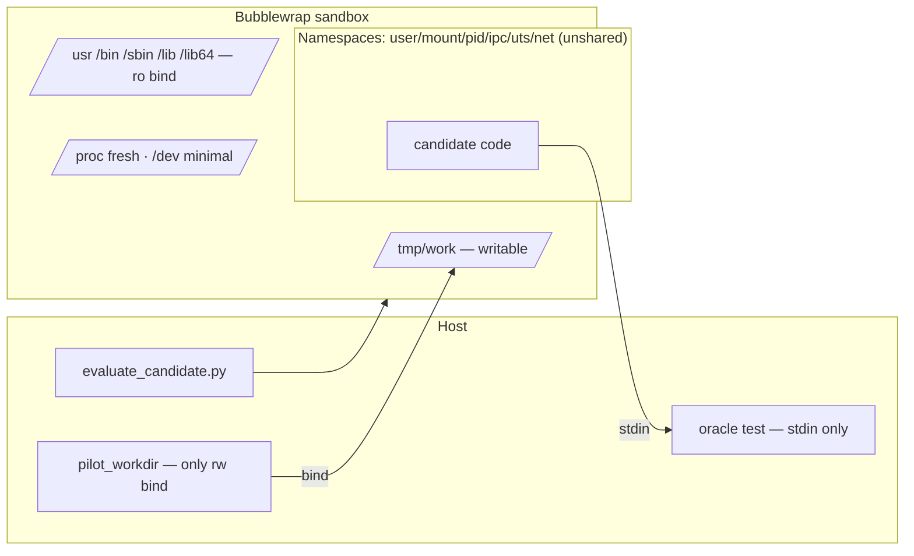
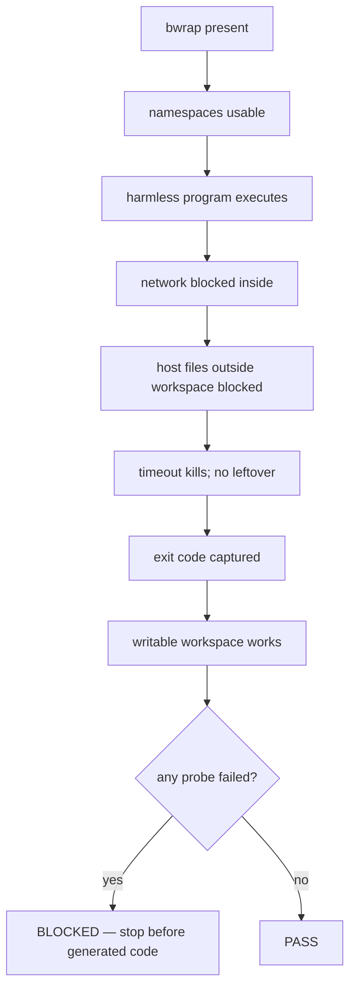
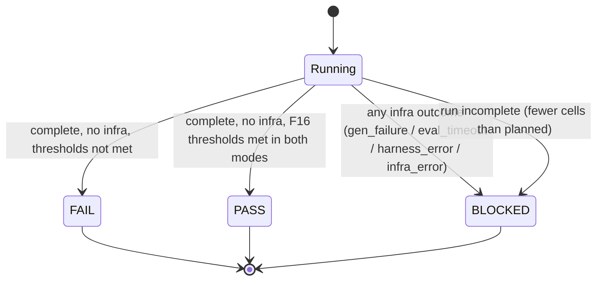
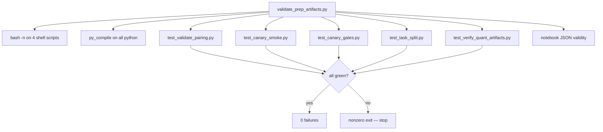
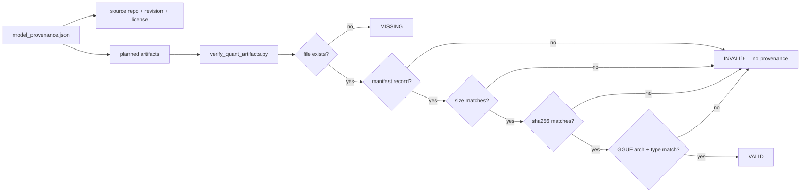
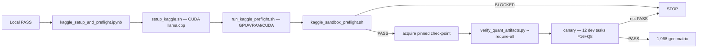

# Hardening & Safeguards — LocalAgentBench

This document details the safety gates, error-handling rules, test suites, and
local validation procedure that protect the experiment's validity and the host
environment. Master readiness verdict: `reports/pre_kaggle_readiness.md` (**PASS**).

---

## 1. Guardrail philosophy

1. **Never count a harness error as a model failure.**
2. **Fail closed:** missing oracle, unverified artifact, unexplained infra error, or incomplete run ⇒ nonzero exit / BLOCKED.
3. **Never execute model-generated code without the validated sandbox.**
4. **Preserve raw outputs** so every score is reproducible.
5. **Do not run a large experiment merely because infrastructure is ready** — gates decide.

---

## 2. Sandbox model

### Sandbox preflight (`kaggle_sandbox_preflight.sh`)

- Local verdict: **PASS (7/7 probes)** on WSL Ubuntu.
- Kaggle result is **pending** until run in the real GPU notebook — local PASS is not claimed as Kaggle compatibility.
- There is **no unsandboxed fallback**; a BLOCKED sandbox stops the run.

---

## 3. Verdict logic (canary)

### Outcome classification

| Stage | Outcome possibilities |
|---|---|
| generate | `pass` path → gen records; rc ≠ 0 → `gen_failure`; exception → `infra_error` |
| extract | `ok-def` → evaluate; else `extraction_rejected` (kind recorded); exception → `infra_error` |
| evaluate | rc 0–4 → model outcomes; rc 5 + TIMEOUT → `eval_timeout`; rc 5 else → `harness_error`; exception → `infra_error` |

### Thresholds (F16, per mode)

| Metric | Threshold |
|---|---|
| Extractable | ≥ 9/12 |
| Syntax-valid | ≥ 8/12 |
| Functional | ≥ 3/12 |

---

## 4. Test suites

All suites run under `.venv/bin/python scripts/validate_prep_artifacts.py` (master gate), which runs:

### What the suites assert (acceptance criteria)

| Requirement | Coverage |
|---|---|
| Harness error ⇒ BLOCKED, not a model failure | `test_canary_gates.py` |
| Incomplete canary cannot pass | `test_canary_gates.py` |
| Missing oracle ⇒ validation failure | `test_validate_pairing.py` (with `--require-oracle`) |
| Duplicate / unknown / non-12 dev task IDs rejected | `test_canary_smoke.py`, `test_pre_kaggle_acceptance.py` |
| Development task cannot enter confirmatory set | `test_task_split.py` |
| Invalid / unverified quantization artifact not reused | `test_verify_quant_artifacts.py` |
| Sandbox failure prevents generated-code execution | `kaggle_sandbox_preflight.sh` (BLOCKED exits) |
| Prompt/generation token counts recorded | `run_canary.py` records; tested via generate/records shape |
| Existing regression suites still pass | master gate + legacy suites |

---

## 5. Provenance & artifact verification

- `quantize_gguf.sh` is idempotent (skips existing outputs) but the **verifier always runs independently** — existence never substitutes for verification.
- No model has been downloaded or quantized during preparation; all artifacts are `MISSING` until the approved Kaggle phase.

---

## 6. Kaggle readiness gates

- GPU/VRAM are detected dynamically; two GPUs are never assumed to pool memory.
- Model acquisition is restartable; state persists under `/kaggle/working` and is exported to `/kaggle/output`.
- No credentials are stored in the repo; the repo URL is public-facing.

---

## 7. Local validation output (executed 2026-11-01)

| Gate | Result |
|---|---|
| bash -n (setup/preflight/quantize/sandbox-preflight) | PASS |
| py_compile (all modules + suites) | PASS |
| test_validate_pairing | PASS (incl. missing-oracle fail-closed) |
| test_canary_smoke | PASS |
| test_canary_gates | PASS |
| test_task_split | PASS |
| test_verify_quant_artifacts | PASS |
| validate_pairing_164 --require-oracle | PASS (164/164, 0 leaks, 0 anomalies) |
| kaggle_sandbox_preflight | PASS (7/7 local) |
| verify_quant_artifacts --require-all | all MISSING ⇒ nonzero (correct) |
| Master gate | **0 failures** |

---

## 8. Remaining blockers / decisions

1. **No GitHub remote** — push commands ready; awaiting user repo decision.
2. **Kaggle GPU session** — the only *unexecuted* gate (build, acquire, canary, matrix).
3. **Qwen 3B license** — Qwen Research (non-commercial); no weight redistribution; review before public release.
